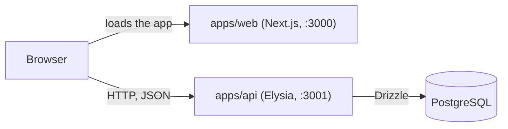

# Architecture overview

Sava Daily Drilling Report is a web application for recording and reviewing daily drilling reports. This document describes how the system is built today and what is planned. Items marked **(planned)** do not exist yet.

## Stack

| Layer          | Technology                                  |
| -------------- | ------------------------------------------- |
| Runtime        | Bun                                         |
| API            | Elysia                                      |
| Web            | Next.js 16, React 19, Tailwind CSS 4        |
| Charts         | TanStack Charts (`@tanstack/charts`)        |
| Database       | PostgreSQL with Drizzle ORM and drizzle-kit |
| Validation     | zod                                         |
| Lint / format  | Biome (one shared config at the repo root)  |
| Language       | TypeScript, strict mode                     |
| Infrastructure | Docker Compose, Nginx **(planned)**         |

## System context

- The web app is client-only: Next.js serves the app, but all code that calls the API runs in the browser. There is no server-side rendering or data fetching in Next.js.
- The browser calls the API directly, so the API allows the web origin through CORS (`WEB_ORIGIN`).
- Only the API talks to the database. The web app never queries Postgres directly.
- The database layer lives in `apps/api/src/db`: a `pg` connection pool, the Drizzle client (`db`), and the schema. It has no tables yet. Tables, repositories and the controller -> service -> repository layering are **(planned)**.

## Monorepo

One repository with Bun workspaces (`apps/*`). Two apps today:

- `apps/api`: the Elysia HTTP API.
- `apps/web`: the Next.js frontend.

Shared tooling lives at the repo root: `biome.json`, `tsconfig.base.json` and the root `package.json` scripts (`dev`, `lint`, `format`, `typecheck`, `build`). See [02-folder-structure.md](02-folder-structure.md).

## API design

- `app.ts` builds the Elysia app and `index.ts` starts the server. They are separate so tests can call the app without opening a port.
- Configuration comes from environment variables validated with zod in `src/config/env.ts`. The API refuses to start if they are invalid.
- Layering **(planned)**: controller (routes) -> service (business rules) -> repository (Drizzle queries).
- Business rules live once, in the backend. The web app displays results and does not recompute them.
- Response shape **(planned)**: `{ data, meta? }` on success and `{ code, message, errors? }` on failure.

## Configuration

| Variable              | Used by | Default                 | Notes                                      |
| --------------------- | ------- | ----------------------- | ------------------------------------------ |
| `NODE_ENV`            | api     | `development`           | `development`, `production` or `test`      |
| `API_PORT`            | api     | `3001`                  | 1 to 65535                                 |
| `DATABASE_URL`        | api     | none                    | Required. `postgres://` or `postgresql://` |
| `WEB_ORIGIN`          | api     | `http://localhost:3000` | Browser origin allowed by CORS             |
| `NEXT_PUBLIC_API_URL` | web     | `http://localhost:3001` | API base URL for the Eden client           |

`.env` files are git-ignored. Only `.env.example` is tracked, one per app (`apps/api` and `apps/web`). Copy it to `.env` to start.

## Related documents

- [02-folder-structure.md](02-folder-structure.md): where code lives.
- [03-git-workflow.md](03-git-workflow.md): branches, commits and pull requests.
- [04-ci-pipeline.md](04-ci-pipeline.md): the checks every pull request must pass.
