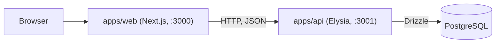

# Architecture overview

Sava Daily Drilling Report is a web application for recording and reviewing daily drilling reports. This document describes how the system is built today and what is planned. Items marked **(planned)** do not exist yet.

## Stack

| Layer          | Technology                                  |
| -------------- | ------------------------------------------- |
| Runtime        | Bun                                         |
| API            | Elysia                                      |
| Web            | Next.js 16, React 19, Tailwind CSS 4        |
| Database       | PostgreSQL with Drizzle ORM and drizzle-kit |
| Validation     | zod                                         |
| Lint / format  | Biome (one shared config at the repo root)  |
| Language       | TypeScript, strict mode                     |
| Infrastructure | Docker Compose, Nginx **(planned)**         |

## System context

- The browser only talks to the web app. The web app calls the API.
- Only the API talks to the database. The web app never queries Postgres directly.
- The database layer **(planned)** lives in `apps/api/src/db`. Drizzle config already points there.

## Monorepo

One repository with Bun workspaces (`apps/*`). Two apps today:

- `apps/api`: the Elysia HTTP API.
- `apps/web`: the Next.js frontend.

Shared tooling lives at the repo root: `biome.json`, `tsconfig.base.json` and the root `package.json` scripts (`dev`, `lint`, `format`, `typecheck`, `build`). See [02-folder-structure.md](02-folder-structure.md).

## API design

- `app.ts` builds the Elysia app and `index.ts` starts the server. They are separate so tests can call the app without opening a port.
- Configuration comes from environment variables validated with zod in `src/config/env.ts`. The API refuses to start if they are invalid.
- Layering **(planned)**: controller (routes) -> service (business rules) -> repository (Drizzle queries).
- Business rules live once, in the backend. The web app displays results and does not recompute them.
- Response shape **(planned)**: `{ data, meta? }` on success and `{ code, message, errors? }` on failure.

## Configuration

| Variable       | Used by | Default       | Notes                                      |
| -------------- | ------- | ------------- | ------------------------------------------ |
| `NODE_ENV`     | api     | `development` | `development`, `production` or `test`      |
| `API_PORT`     | api     | `3001`        | 1 to 65535                                 |
| `DATABASE_URL` | api     | none          | Required. `postgres://` or `postgresql://` |

`.env` files are git-ignored. Only `.env.example` is tracked **(planned)**.

## Related documents

- [02-folder-structure.md](02-folder-structure.md): where code lives.
- [03-git-workflow.md](03-git-workflow.md): branches, commits and pull requests.
